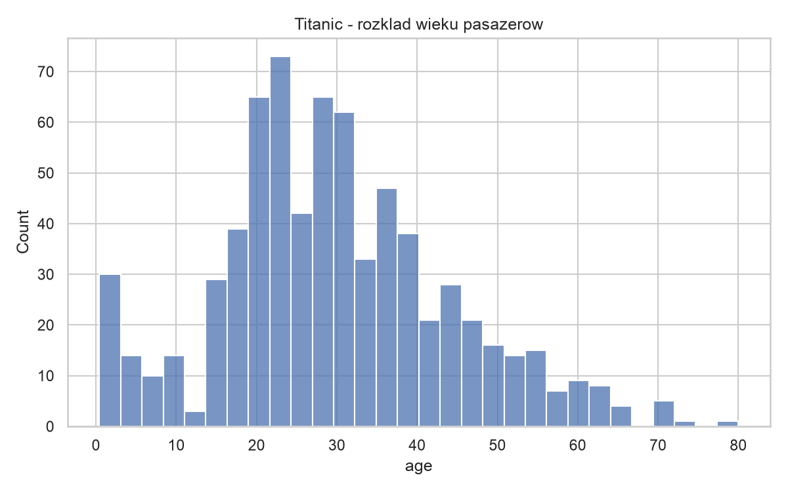
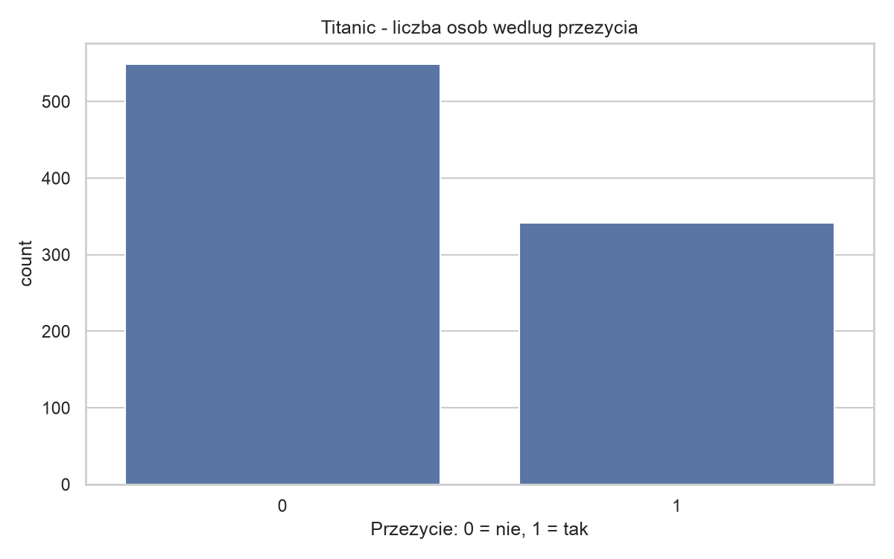
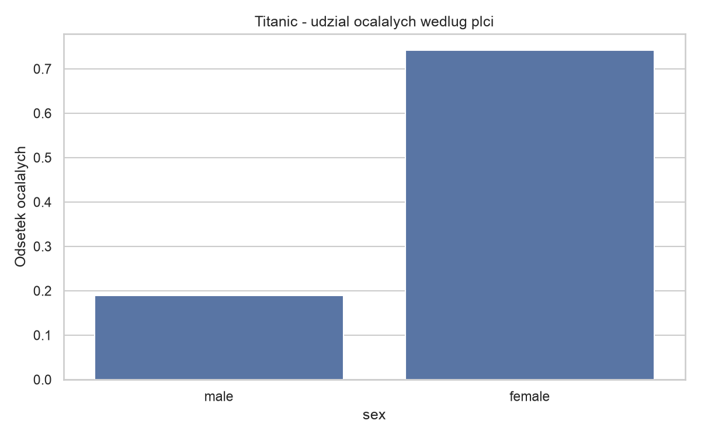
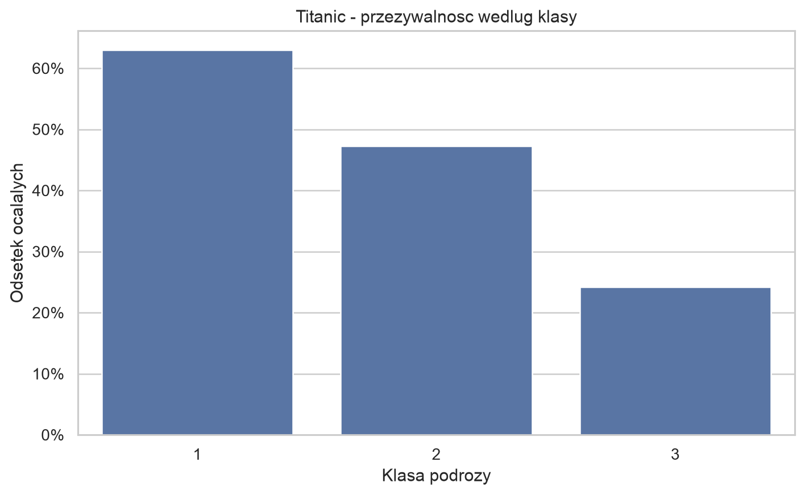
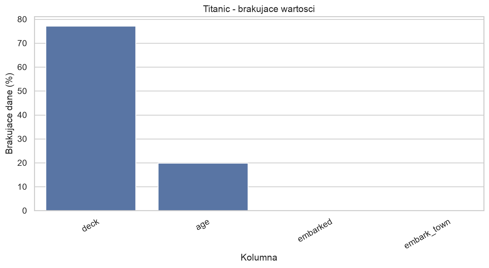
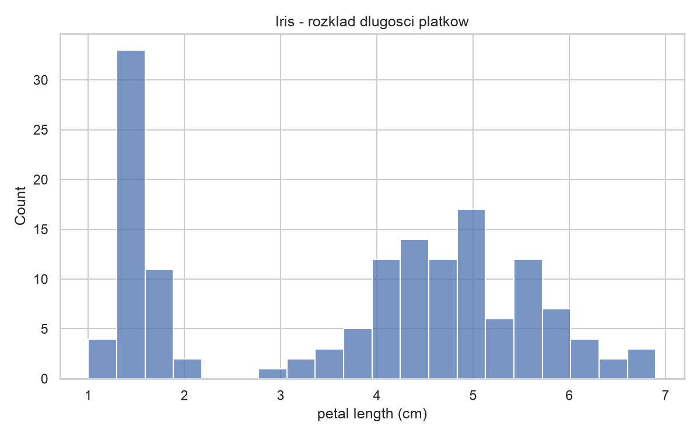
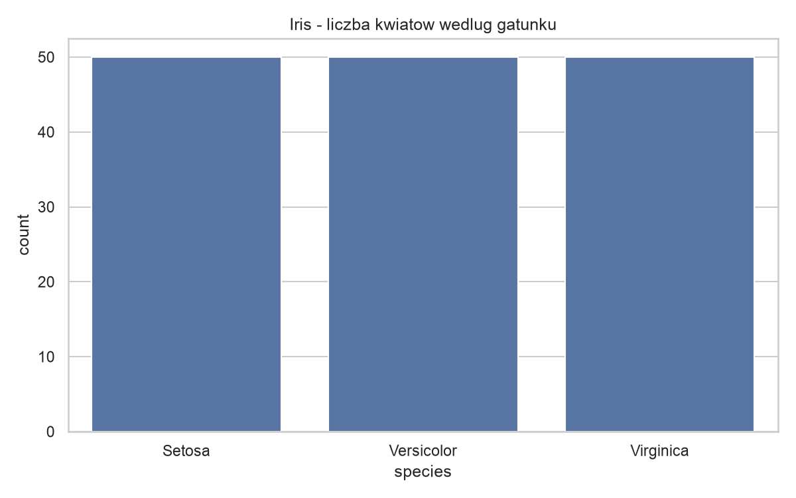
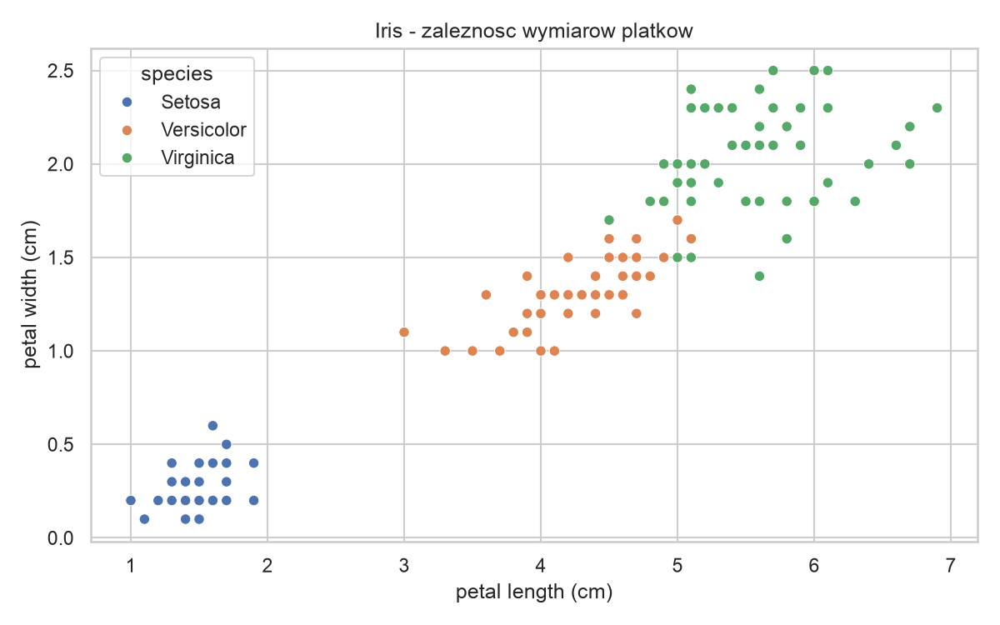
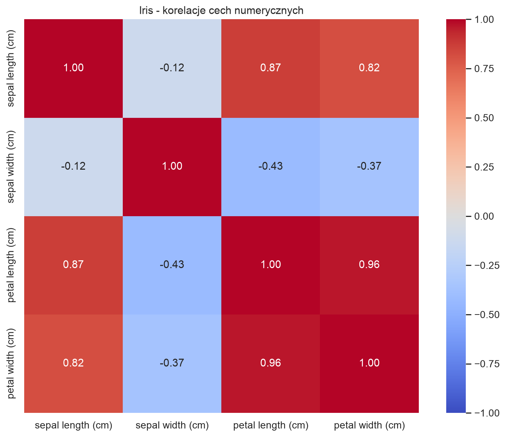

# Raport EDA — Zadanie 1

## 1. Cel

Eksploracyjna analiza dwóch zbiorów danych:
Titanic i Iris, załadowanych przez Kedro Data Catalog.

## 2. Titanic

**Źródło:** seaborn-data.

**Rozmiar:** 891 rekordów, 15 kolumn.

### Najważniejsze zmienne

- `survived` — informacja o przeżyciu (0 lub 1).
- `sex` — płeć pasażera.
- `pclass` — klasa podróży.

Dodatkowo przeanalizowano wiek (`age`).

### Jakość danych

- `age`: 177 braków (19,87%).
- `deck`: 688 braków (77,22%).
- `embarked`: 2 braki.
- `embark_town`: 2 braki.
- 107 powtarzających się wierszy.

Powtarzające się wiersze nie muszą oznaczać błędów,
ponieważ różni pasażerowie mogą posiadać
identyczne opisane cechy.

### Wyniki

Łączna przeżywalność: 38,38%.

| Płeć | Przeżywalność |
|---|---:|
| Kobiety | 74,20% |
| Mężczyźni | 18,89% |

| Klasa podróży | Przeżywalność |
|---|---:|
| Pierwsza | 62,96% |
| Druga | 47,28% |
| Trzecia | 24,24% |

Zaobserwowano wyższą przeżywalność wśród kobiet
oraz pasażerów pierwszej klasy. Są to zależności
obserwacyjne, a nie dowód związku przyczynowego.

Wiek ma rozkład skupiony głównie wokół
młodych i średnich grup wiekowych.

## 3. Iris

**Źródło:** scikit-learn, load_iris.

**Rozmiar:** 150 rekordów, 5 kolumn.

### Najważniejsze zmienne

- `petal length (cm)` — długość płatka.
- `petal width (cm)` — szerokość płatka.
- `target` — gatunek kwiatu (0, 1 lub 2).

### Jakość danych

- Brak brakujących wartości.
- Jeden powtarzający się wiersz.
- Po 50 obserwacji każdego gatunku.

### Wyniki

| Gatunek | Średnia długość płatka |
|---|---:|
| Setosa | 1,46 cm |
| Versicolor | 4,26 cm |
| Virginica | 5,55 cm |

Korelacja długości i szerokości płatków
wynosi 0,963, co oznacza bardzo silną dodatnią
zależność liniową w całym zbiorze.

Na wykresie punktowym Setosa jest wyraźnie
oddzielona od pozostałych gatunków,
natomiast Versicolor i Virginica częściowo
nakładają się na siebie.

## 4. Porównanie zbiorów

| Cecha | Titanic | Iris |
|---|---|---|
| Rekordy | 891 | 150 |
| Kolumny | 15 | 5 |
| Dane | Liczbowe i kategoryczne | Numeryczne i cel |
| Braki | Występują | Brak |
| Cel | Przeżycie | Gatunek kwiatu |

Titanic wymaga większej uwagi w zakresie
jakości danych. Iris jest zbiorem kompletnym
i ma równomierny rozkład klas.

## 5. Możliwe wspólne wykorzystanie w Kedro

Zbiory nie posiadają wspólnego klucza
umożliwiającego bezpośrednie połączenie rekordów.

Można wykorzystać dwa niezależne przepływy
danych w jednym projekcie Kedro, stosujące
wspólne zasady kontroli jakości i raportowania.

Titanic wymagałby obsługi braków i zmiennych
kategorycznych, a Iris prostszego przetwarzania
cech liczbowych.

Jest to wyłącznie koncepcja, bez implementacji.

## 6. Wykresy

### Titanic — rozkład wieku

### Titanic — przeżycie

### Titanic — płeć

### Titanic — klasa

### Titanic — braki danych

### Iris — długość płatków

### Iris — gatunki

### Iris — zależność cech

### Iris — korelacje

